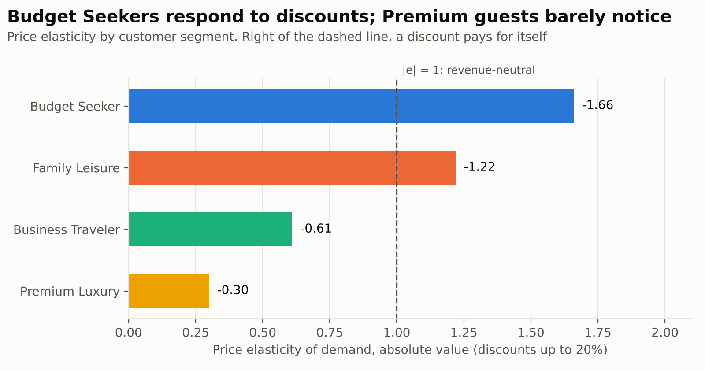
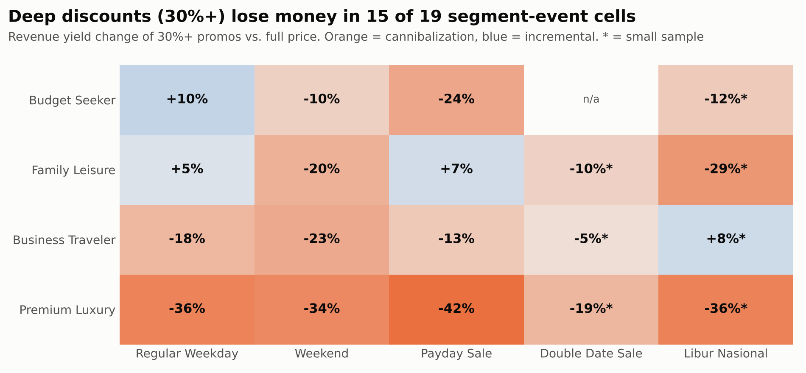
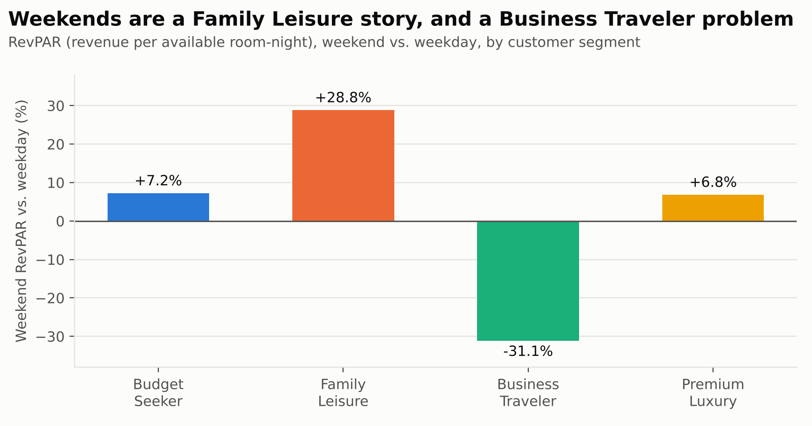
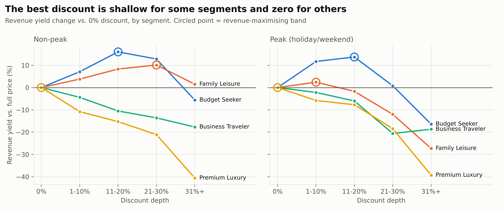

# Dynamic Pricing & Promotional Elasticity Analysis

> **End-to-end commercial analytics project:** synthetic data generation (Python) → advanced SQL (PostgreSQL) → pricing & promotion strategy.
> Domain: online travel / hospitality, applicable to e-commerce.


---

## 1. Executive Summary

A marketplace discounted **71% of its bookings by an average of 23 percentage points** but never asked *who* the discount was working on. This project quantifies price elasticity by category and customer segment, finds where promotions destroy revenue, and turns the result into a segment-level discount playbook.

**What the analysis found (on 2,000 bookings, 32 properties, May-Oct 2026):**

- **Elasticity is a segment story.** Budget Seekers are elastic (-1.66), Family Leisure is borderline elastic (-1.22), Business (-0.61) and Premium (-0.30) guests are inelastic: cutting price for them mostly gives revenue away.
- **Deep promotions (30%+) cannibalized revenue in 15 of 19 segment-event cells**, roughly **IDR 2.8 bn (≈5% of analysed revenue)** below a full-price counterfactual.
- **48% of deep-promo bookings sold out completely.** The discount bought no extra volume because the room would have sold anyway.
- **Weekends help Family Leisure (RevPAR +29%) and hurt Business Travelers (-31%)**, yet promo penetration is almost identical on both.
- **Recommended policy:** cap Budget Seeker discounts at 20%, discount Family only off-peak, stop price-led promos for Business/Premium, and switch deep promos off when forecast occupancy approaches capacity.

> **Transparency note:** the dataset is synthetic and generated from a documented demand model (known elasticities, capacity limits, brand-dilution effect). That lets me check that each SQL method *recovers* the planted truth (see [Methodology](#4-methodology)). It is a demonstration of method and decision framework, not a claim about a real company.

**Interactive dashboard:** [`dashboard/index.html`](dashboard/index.html) is a self-contained web app (no server, no install). Filter by category, segment, event and month, and every KPI, chart and ranking recomputes in the browser. Download the file and open it in any browser, or publish it with GitHub Pages.

---

## 2. Business Problem

Promotions are the most common lever for lifting demand and the most common source of silent margin leakage. Three questions drive this project:

1. **Who is price-sensitive?** How much does volume move per 1% price change, by category and customer segment?
2. **When do discounts backfire?** In which segment × event combinations does a deep discount produce *less* revenue than the normal price (promo cannibalization)?
3. **Where should the promo budget go?** Which properties return the most revenue per point of discount, and what discount depth is revenue-maximising for each segment?

**Success metric:** Revenue Yield = `(final_price × units) / (base_price × rooms_available)`, the share of maximum potential revenue captured. It is comparable across properties with a 15× price range and equals RevPAR indexed to rack rate.

---

## 3. Dataset Overview

Generated by [`src/generate_dataset.py`](src/generate_dataset.py) (seeded, reproducible). One row = one **property × customer segment × stay date** booking batch.

| Column | Description |
|---|---|
| `transaction_id` | Unique booking-batch ID (`TRX-00001`…) |
| `date` | Stay date, 1 May - 31 Oct 2026 |
| `property_or_product_id` | 32 properties (`PRP-001`…`PRP-032`), 8 per category |
| `category` | Budget Hotel / Midscale Hotel / Upscale Hotel / Luxury Resort |
| `base_price` | Dynamic rack rate per room-night (IDR), higher on weekends/holidays |
| `discount_percentage` | 0-50% |
| `final_price` | `base_price × (1 - discount)` |
| `units_sold_or_booked` | Room-nights booked |
| `customer_segment` | Budget Seeker / Family Leisure / Business Traveler / Premium Luxury |
| `event_flag` | Regular Weekday / Weekend / Libur Nasional / Payday Sale / Double Date Sale |
| `competitor_price` | Competitor rate for comparable room (~2% missing, as in scraped data) |
| `rooms_available` | *(added)* inventory allocated to the slot; enables occupancy and capacity analysis |

**Size:** 2,000 rows · 51,921 room-nights · IDR 52.8 bn gross revenue · 71% of rows discounted · 28% at 30%+ off.

**Patterns deliberately planted** (so that methods can be validated):

| Pattern | Implementation |
|---|---|
| Segment elasticity | True \|e\|: Budget Seeker 2.3 → Premium 0.35, scaled by category (Budget hotels ×1.15 … Luxury ×0.75) |
| Premium brand dilution | Extra volume penalty of -8% (30-39% off) and -18% (40%+ off) |
| Event demand | Holiday ×1.35-1.70 for leisure segments, ×0.60 for Business; weekends boost Family/Premium, hurt Business |
| Inventory cap | `units ≤ rooms_available` → deep discounts on busy days are wasted |
| Non-random promo policy | Sale days and Budget Seekers receive deeper discounts (realistic confounding) |

---

## 4. Methodology

| Step | Tooling | Detail |
|---|---|---|
| 1. Generate | Python (pandas, numpy) | Demand model: `λ = base × event × (1-d)^(-e) × dilution × competitor_effect × noise`, `units = min(Poisson(λ), capacity)` |
| 2. Load | PostgreSQL 16 | [`sql/00_schema_and_load.sql`](sql/00_schema_and_load.sql): typed schema with `CHECK` constraints, `\copy`, indexes |
| 3. Analyse | Advanced SQL | Five queries in [`sql/`](sql/): CTEs, `LAG`, `FIRST_VALUE`, `RANK`, `SUM() OVER`, `AVG() FILTER … OVER`, `REGR_SLOPE`, `LATERAL`, `HAVING` guard-rails |
| 4. Export & visualise | Python | [`src/run_analysis.py`](src/run_analysis.py) → `outputs/*.csv` → [`src/make_charts.py`](src/make_charts.py) |

| Query | Business question | Techniques |
|---|---|---|
| [`01_price_elasticity.sql`](sql/01_price_elasticity.sql) | % Δ volume vs % Δ price, by category and segment | Arc elasticity with `LAG`; fixed-effects log-log slope with `REGR_SLOPE` over de-meaned windows; `LATERAL` to report two dimensions in one pass |
| [`02_promo_cannibalization.sql`](sql/02_promo_cannibalization.sql) | When does a 30%+ promo earn less than full price? | `AVG() FILTER … OVER` counterfactual baseline, revenue-at-risk in IDR, sold-out diagnostic, sample-size confidence flag |
| [`03_weekend_vs_weekday.sql`](sql/03_weekend_vs_weekday.sql) | Weekend vs weekday by segment | Occupancy / ADR / RevPAR, `LAG` deltas, `SUM() OVER` revenue mix, `RANK` |
| [`04_promo_efficiency_ranking.sql`](sql/04_promo_efficiency_ranking.sql) | Top 10 properties by uplift per discount point | Per-property uplift vs. full price, `RANK` overall and within category, minimum-sample guard |
| [`05_optimal_discount_matrix.sql`](sql/05_optimal_discount_matrix.sql) | Which discount depth maximises yield? | Segment × demand-context matrix, `FIRST_VALUE` benchmark, `RANK` to flag optimum |

**Analytical choices worth noting**

- **Normalisation.** Volume is measured as occupancy (`units / rooms_available`) and price as `final_price / base_price`, so a Rp 300k hotel and a Rp 5m resort can be compared.
- **Controlling for events.** The log-log elasticity de-means inside each category × segment × event cell, so holiday demand is not mistaken for a price effect.
- **Censored demand.** Occupancy cannot exceed 100%. The headline elasticity therefore uses discounts ≤20% (before saturation); the all-rows estimate is also reported and is visibly attenuated.
- **Validation against ground truth.** Planted (base) vs. recovered |elasticity|: Premium 0.35 → 0.30, Business 0.60 → 0.61, Family 1.40 → 1.22, Budget Seeker 2.30 → 1.66. Ordering and the elastic/inelastic classification are recovered; the most elastic segment is under-estimated because it hits the capacity ceiling.
- **Small-sample honesty.** Event cells with fewer than 15 records per side are tagged `Low (directional)` (marked * in the heatmap).

---

## 5. Key Insights

### 5.1 Elasticity is driven by customer segment more than by property category



| Dimension | Group | Elasticity (≤20% off) | Verdict |
|---|---|---|---|
| Segment | Budget Seeker | -1.66 | Elastic |
| Segment | Family Leisure | -1.22 | Elastic |
| Segment | Business Traveler | -0.61 | Inelastic |
| Segment | Premium Luxury | -0.30 | Inelastic |
| Category | Budget Hotel | -1.27 | Elastic |
| Category | Midscale Hotel | -1.19 | Elastic |
| Category | Luxury Resort | -0.75 | Inelastic |
| Category | Upscale Hotel | -0.56 | Inelastic |

**Diminishing returns:** for Budget Seekers, the first 1-10% of discount lifts volume +20% (arc elasticity -2.4). Going from 21-30% to 31%+ adds just **+1.3% volume for a 17.5% price cut**, because occupancy is already 100%.

### 5.2 Deep discounts cannibalize revenue in 15 of 19 segment-event cells



- **Premium Luxury loses 34-42%** of revenue yield on deep promos in every event with adequate sample; net impact ≈ **-IDR 1.76 bn** (largest single segment).
- **Budget Seekers and Family Leisure** lose on weekends and payday/holiday campaigns because **inventory is already sold out** (Budget Seeker deep promos on weekends and payday: 100% sold-out; Family weekends: 94%).
- **Only three high-confidence cells are incremental:** Budget Seeker on regular weekdays (+9.9%), Family on regular weekdays (+4.9%) and on payday (+6.9%).

### 5.3 Weekends are a Family Leisure opportunity and a Business Traveler problem



| Segment | Weekend occupancy | Weekend RevPAR vs weekday | Promo penetration (wkday → wkend) |
|---|---|---|---|
| Family Leisure | 88.6% | **+28.8%** | 70.1% → 69.8% |
| Premium Luxury | 68.5% | +6.8% | 71.8% → 66.7% |
| Budget Seeker | 91.1% | +7.2% | 75.2% → 75.0% |
| Business Traveler | 47.2% | **-31.1%** | 71.9% → 67.8% |

Family guests fill 89% of rooms on weekends yet still receive discounts on 70% of bookings: pure leakage. Business weekends are weak, but their inelastic demand means discounts will not fix it.

### 5.4 Promo efficiency varies widely by property

| Rank | Property | Category | Avg discount (pp) | Revenue uplift vs full price | Uplift per discount pp |
|---|---|---|---|---|---|
| 1 | PRP-003 | Budget Hotel | 21.4 | +15.6% | **0.73** |
| 2 | PRP-008 | Budget Hotel | 24.8 | +14.1% | **0.57** |
| 3 | PRP-019 | Upscale Hotel | 24.4 | +8.8% | 0.36 |
| 4 | PRP-011 | Midscale Hotel | 22.6 | +7.0% | 0.31 |
| 5 | PRP-015 | Midscale Hotel | 22.4 | +6.7% | 0.30 |
| 6 | PRP-006 | Budget Hotel | 21.2 | +5.8% | 0.28 |
| 7 | PRP-002 | Budget Hotel | 24.7 | +6.3% | 0.26 |
| 8 | PRP-010 | Midscale Hotel | 24.2 | +4.7% | 0.19 |
| 9 | PRP-001 | Budget Hotel | 21.7 | +2.2% | 0.10 |
| 10 | PRP-013 | Midscale Hotel | 26.5 | +2.1% | 0.08 |

The top 10 are 5 Budget and 4 Midscale hotels plus 1 Upscale. **All 8 Luxury Resorts and 7 of 8 Upscale Hotels have negative promo uplift**, and 3 of 8 Budget hotels do too: even in an elastic category, property-level execution matters.

### 5.5 The revenue-maximising discount depth differs by segment and context



| Segment | Non-peak optimum | Peak (holiday/weekend) optimum |
|---|---|---|
| Budget Seeker | 11-20% (+16.0% yield vs full price) | 11-20% (+13.7%) |
| Family Leisure | 21-30% (+10.1%) | 1-10% (+2.4%) |
| Business Traveler | **0%** | **0%** |
| Premium Luxury | **0%** (31%+ costs -40.6%) | **0%** (31%+ costs -39.3%) |

---

## 6. Business Recommendations

**1. Actionable Pricing Strategy: price by segment, not by calendar**
- Cap Budget Seeker discounts at 20%; beyond that, the room is full and the discount is pure margin loss.
- Discount Family Leisure only off-peak (21-30%); at most 1-10% on weekends and holidays; raise weekend rates (RevPAR +29% at 89% occupancy).
- Stop price-led promos for Business and Premium guests. Use value-adds (breakfast, late checkout, upgrade) instead.

**2. Target Promo Optimization: spend where it returns revenue**
- Automatically close deep promos when forecast occupancy exceeds ~85-90% (48% of deep-promo bookings sold out).
- Re-allocate promo budget toward the top-efficiency properties (PRP-003, PRP-008) and remove Luxury Resorts and most Upscale hotels from standard promo calendars.
- Replace blanket payday / double-date campaigns with segment-targeted offers (Family on payday was the only positive result: +7%).

**3. Risk Mitigation**
- Validate with an A/B or geo hold-out on 4-6 properties before chain-wide rollout (promo depth here was not randomised).
- Re-run on contribution margin, not just revenue (volume gains carry variable cost and commission).
- Hard-cap Premium discounts (brand dilution) and monitor competitor prices for price-war risk.
- Treat holiday/double-date cells (5-15 records) as directional until more data accrues.

Full memo: [`docs/executive_summary.md`](docs/executive_summary.md)

---

## 7. Repository Structure

```
dynamic-pricing-portfolio/
├── README.md
├── requirements.txt
├── data/
│   └── pricing_transactions.csv         # 2,000 synthetic bookings (seed 42)
├── src/
│   ├── generate_dataset.py              # demand model + dataset generator
│   ├── run_analysis.py                  # runs every SQL file, exports CSVs
│   ├── make_charts.py                   # builds README charts
│   └── build_dashboard.py               # embeds the CSV into the web dashboard
├── dashboard/
│   ├── template.html                    # dashboard source (HTML + JS, no dependencies)
│   └── index.html                       # built page with the data embedded
├── sql/
│   ├── 00_schema_and_load.sql
│   ├── 01_price_elasticity.sql
│   ├── 02_promo_cannibalization.sql
│   ├── 03_weekend_vs_weekday.sql
│   ├── 04_promo_efficiency_ranking.sql
│   └── 05_optimal_discount_matrix.sql
├── outputs/                             # query results (CSV)
├── images/                              # charts used in this README
└── docs/
    └── executive_summary.md
```

## 8. How to Reproduce

```bash
pip install -r requirements.txt
python src/generate_dataset.py                 # writes data/pricing_transactions.csv

createdb pricing
export PGDATABASE=pricing                      # plus PGHOST / PGUSER / PGPORT if needed
psql -f sql/00_schema_and_load.sql             # run from the project root
python src/run_analysis.py                     # exports query results to outputs/
python src/make_charts.py                      # regenerates images/
python src/build_dashboard.py                  # rebuilds dashboard/index.html (open it in a browser)
```

**Publish the dashboard (optional):** in the GitHub repo go to *Settings → Pages*, choose *Deploy from a branch*, branch `main`, folder `/ (root)`. After a minute the dashboard is live at `https://<your-username>.github.io/<repo-name>/dashboard/`.

SQL tested on PostgreSQL 16 (requires 9.4+ for `FILTER` on window aggregates).

## 9. Limitations & Next Steps

- **Synthetic data:** results illustrate method and decision logic, not real market behaviour.
- **Observational elasticity:** promo depth is not randomised; confirm with a controlled price test.
- **Revenue ≠ profit:** extend with cost per occupied room and OTA commission.
- **Next:** a Tableau / Power BI version on the `outputs/` tables; demand forecast (e.g., gradient boosting) feeding an occupancy-triggered promo switch; a price-optimisation simulation per segment.

## 10. Contact

*Your Name* · [LinkedIn](#) · [Portfolio](#) · your.email@example.com
